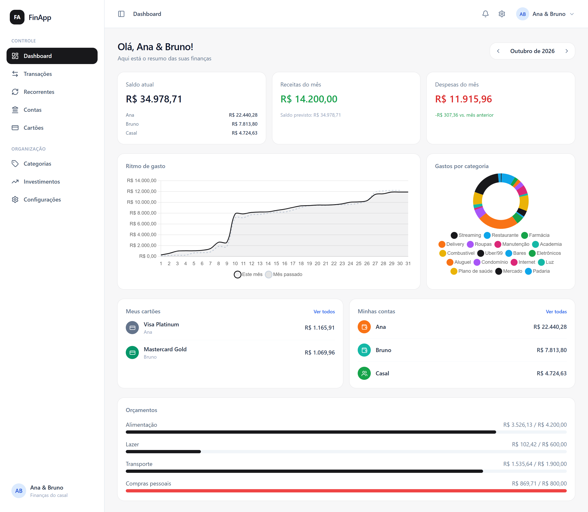
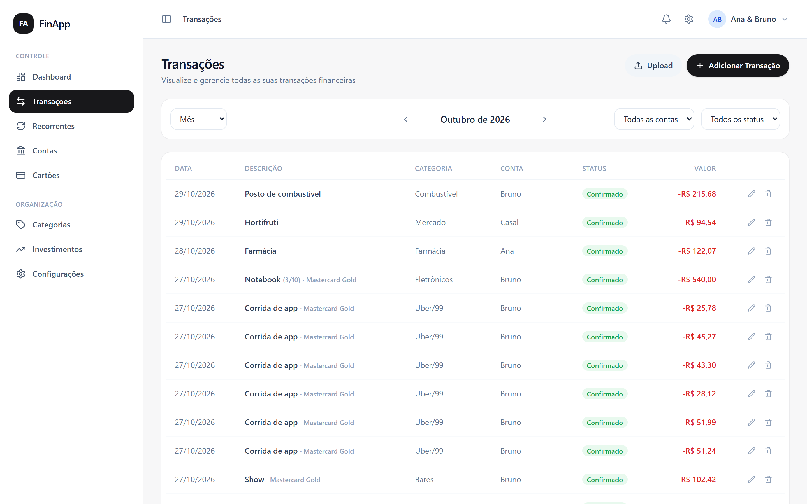
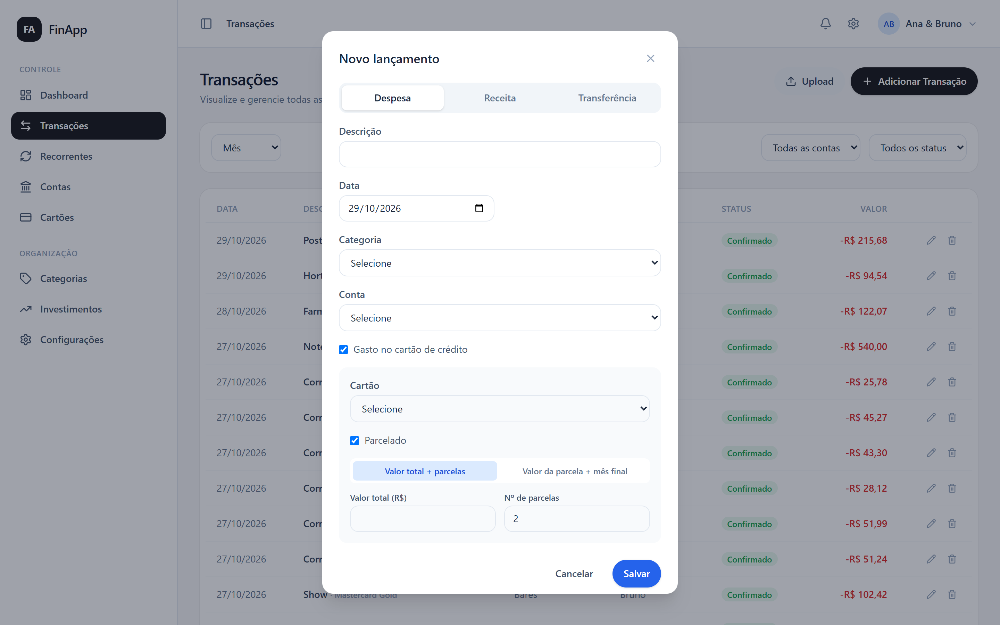
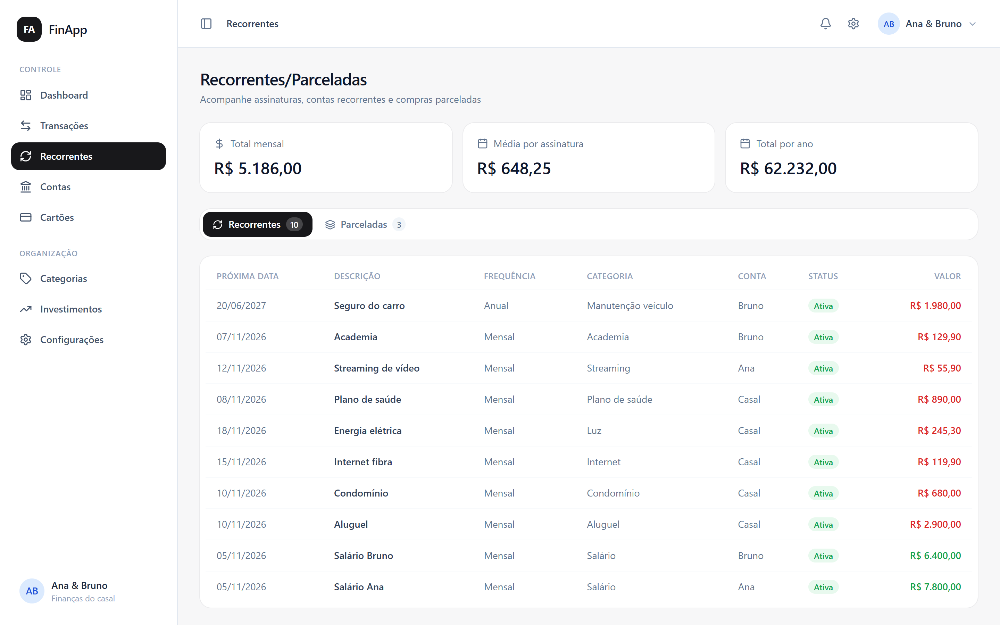
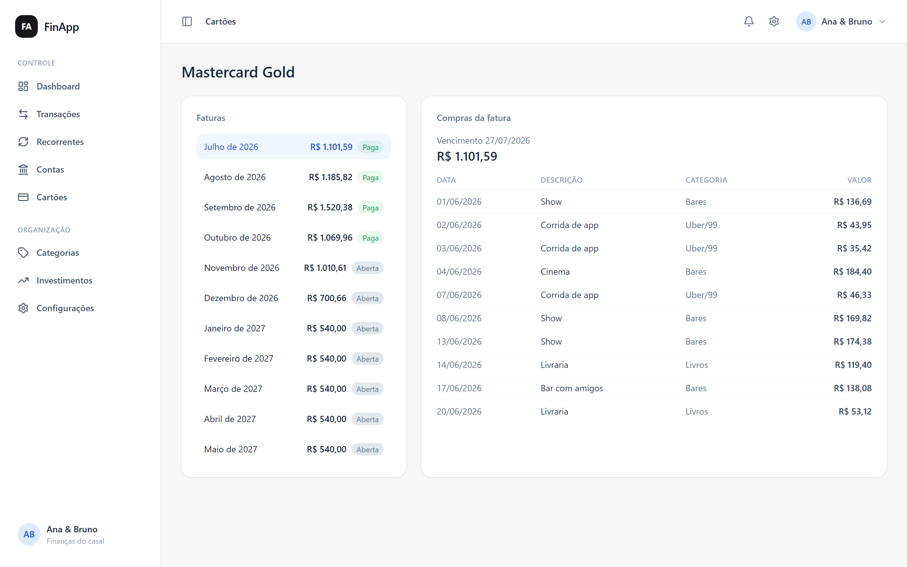
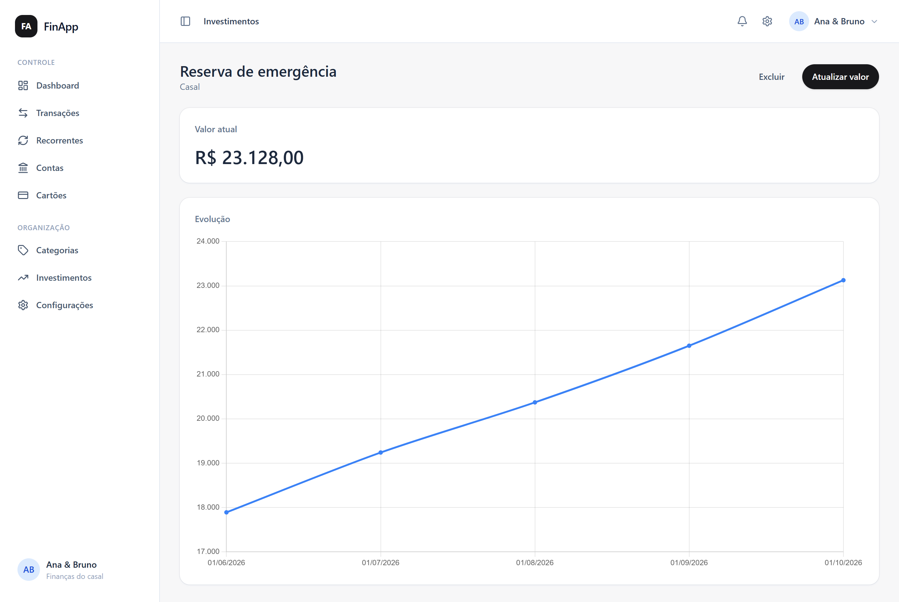
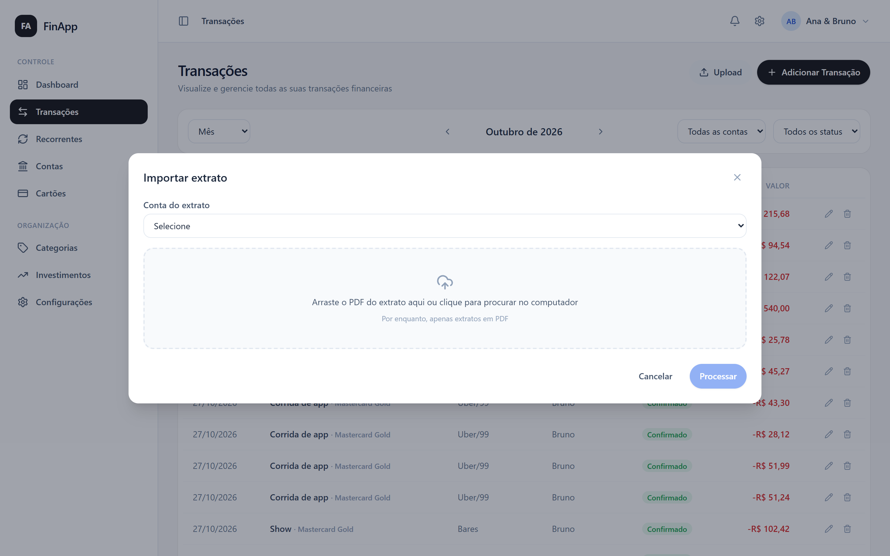
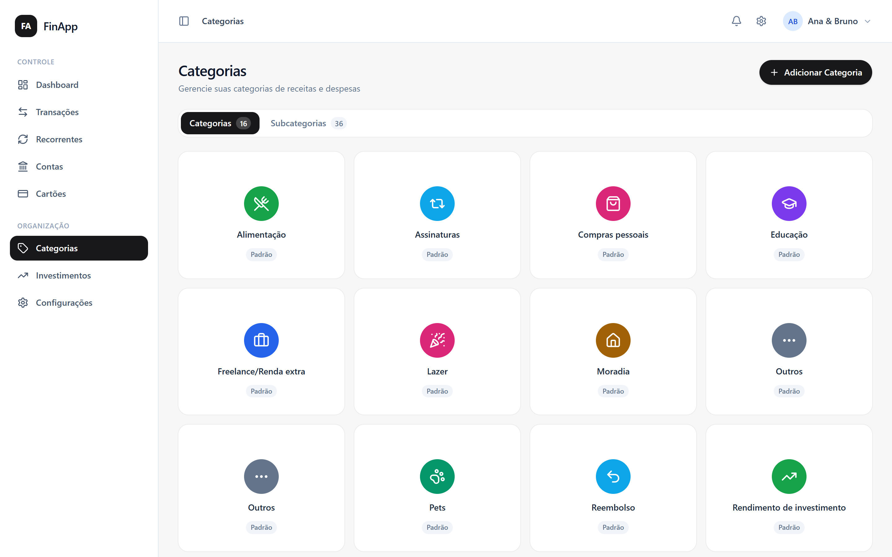

<div align="center">

# FinApp

**Personal finance manager for couples: individual and joint accounts, credit card invoices, installments, recurring bills, budgets, a 3-month forecast and bank statement import.**

[](https://github.com/baxelin/finance-app/actions/workflows/ci.yml)


English · [Português](README.pt-BR.md)



</div>

## Why

Most budgeting apps are built for one person. A couple usually manages money across **three** places: each partner's own account plus a shared one, with credit cards whose purchases only hit the balance when the invoice is due. FinApp models that directly, so the balance you see matches what will actually be in the bank.

> The UI is in Brazilian Portuguese and amounts are in BRL, because the app was built for real use in Brazil.

## Features

| | |
| --- | --- |
| **Accounts** | Two individual accounts and a joint one, with current and projected month balance. Transfers between them are tracked on both sides. |
| **Credit card invoices** | Every purchase is assigned to the invoice it belongs to, based on the card's closing and due days. Card spending only affects the balance when the invoice is paid. |
| **Installments** | Enter "total + number of installments" (rounding cents go to the last one) or "installment amount + final month". All installments can be edited or deleted as a group. |
| **Recurring entries** | Daily to yearly frequencies. Optional auto-confirm (e.g. salary) confirms an occurrence only once its date arrives, so future money never inflates today's balance. |
| **Forecast** | Projects the next 3 months from scheduled entries plus the average of recent variable spending. |
| **Budgets** | Monthly limit per category, counting spending logged in its subcategories too. |
| **Statement import** | Upload bank statement PDFs (Itaú format). FinApp suggests categories, learns from your corrections, detects transfers between the couple's accounts and flags duplicates before anything is saved. |
| **Investments** | Track the value of each investment over time. |

## Screenshots

| Transactions | New entry (card purchase in installments) |
| --- | --- |
|  |  |
| **Recurring entries** | **Credit card invoices** |
|  |  |
| **Investments** | **Statement import** |
|  |  |

<details>
<summary>Categories</summary>



</details>

## Tech stack

- **Frontend:** Vue 3 (Composition API, `<script setup>`), Vite, Pinia, Vue Router, Tailwind CSS 4, Chart.js, Lucide icons
- **Backend:** Node.js 24, Express 5, Prisma ORM, SQLite (behind Prisma, so switching to PostgreSQL only means changing the provider)
- **Testing:** `node:test` for the domain rules, Vitest for the client
- **Delivery:** Multi-stage Docker image serving API and SPA from one process, GitHub Actions CI, multi-arch image published to GHCR

## Architecture

```
finance-app/
├── client/                 Vue SPA
│   └── src/
│       ├── views/          one component per page
│       ├── components/     forms, modals and the ui/ design-system primitives
│       ├── stores/         Pinia stores (accounts, cards, categories)
│       ├── composables/
│       └── lib/            API client, formatting, date helpers, icon registry
├── server/                 Express API
│   ├── src/
│   │   ├── routes/         thin HTTP layer, one router per resource
│   │   └── lib/            domain rules: invoice cycle, installments, recurrence,
│   │                       balances, forecast, statement parsing and matching
│   ├── prisma/             schema, migrations, default seed and demo seed
│   └── test/
├── Dockerfile
└── .github/workflows/      CI and CD
```

The business rules live in small, pure modules under `server/src/lib` and are unit tested on their own. The routes only translate HTTP into calls to those modules and Prisma.

## Getting started

Requires **Node.js 24+**.

```bash
npm run install:all                  # install server and client dependencies
cp server/.env.example server/.env   # configure database path, port and account names
npm run db:migrate                   # create the SQLite database
npm run db:seed:demo                 # optional: load ~4 months of sample data
npm run dev                          # API on :3001, SPA on :5173
```

Open http://localhost:5173. To start empty instead of using the demo data, run `npm run db:seed`, which only creates the accounts and default categories.

### Environment variables (`server/.env`)

| Variable | Default | Description |
| --- | --- | --- |
| `DATABASE_URL` | `file:./dev.db` | SQLite file, relative to `server/prisma/` |
| `PORT` | `3001` | API port |
| `PARTNER_A_NAME` | `Ana` | First individual account |
| `PARTNER_B_NAME` | `Bruno` | Second individual account |
| `JOINT_ACCOUNT_NAME` | `Casal` | Joint account |

### Tests

```bash
npm test --prefix server   # invoice cycle, installments, recurrence, statement import, API health
npm test --prefix client   # formatting and date helpers
```

## Running with Docker

```bash
docker compose up --build -d
```

The app runs at http://localhost:3001. Migrations are applied on startup, and the database is kept in the `finapp_data` volume, so it survives rebuilds (`docker compose down -v` deletes it).

You can also use the published image:

```bash
docker run -d -p 3001:3001 -v finapp_data:/app/server/data ghcr.io/baxelin/finance-app:latest
```

## CI/CD

- **CI** (every push and pull request): server tests against a temporary SQLite database, client tests and production build, and a Docker build check.
- **CD** (pushes to `main` and `v*.*.*` tags): reruns CI, then builds a `linux/amd64` + `linux/arm64` image and pushes it to GitHub Container Registry with the tags `latest`, `sha-<commit>` and the semver version.

---

<div align="center">
Built by <a href="https://github.com/baxelin">baxelin</a>
</div>
